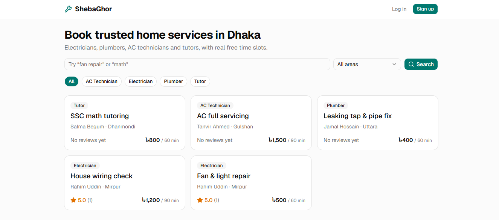

# ShebaGhor

Book electricians, plumbers, AC technicians and tutors in Dhaka. Customers see real free time slots,
pay (SSLCommerz sandbox integration; the live demo uses mock payments), and review the job afterwards.
Providers manage their services and hours; an admin approves new providers.

**Live demo:** https://shebaghor-sajidur.vercel.app · **API:** https://shebaghor-api.onrender.com/api/health

| Demo account | Email                  | Password    |
| ------------ | ---------------------- | ----------- |
| Customer     | customer@shebaghor.dev | password123 |
| Provider     | rahim@shebaghor.dev    | password123 |
| Admin        | admin@shebaghor.dev    | password123 |

> The API runs on Render's free tier and sleeps when idle, so the first request can take ~60 seconds.



## Tech stack

| Layer    | Tech                                                         | Hosted on (free) |
| -------- | ------------------------------------------------------------ | ---------------- |
| Frontend | React 19, Vite, React Router, Axios, Tailwind CSS, shadcn/ui | Vercel           |
| Backend  | Node.js, Express 5, Zod, JWT                                 | Render           |
| Database | PostgreSQL + Prisma                                          | Neon             |
| Payments | SSLCommerz sandbox + mock mode (live demo: mock)             | —                |

## Highlights

- **No double-booking under concurrency.** Booking runs in a transaction that locks the provider's row
  (`SELECT … FOR UPDATE`) and then checks for overlaps. 5 concurrent requests for one slot:
  **with the lock → 1 booking**.
- **Payment hold without a cron job.** Unpaid bookings block a slot for 15 minutes only.
- **Payments verified server-to-server**, with idempotent confirmation (redirect + IPN both safe).
- **Reviews + rating in one transaction**, with a unique `bookingId` and `CHECK (rating BETWEEN 1 AND 5)`.
- **Timezone-correct:** stored in UTC, shown in Asia/Dhaka; slot logic is a pure function with unit tests.

## Run locally

**Requirements:** Node 22+ and a free Neon Postgres database.

```bash
# 1. Backend
cd server
cp .env.example .env          # paste your Neon connection strings
npm install
npx prisma migrate deploy     # creates the tables from the committed migrations
npm run db:seed               # demo users, providers, services, reviews
npm run dev                   # http://localhost:5000/api/health

# 2. Frontend (new terminal)
cd client
cp .env.example .env
npm install
npm run dev                   # http://localhost:5173
```

`PAYMENT_MODE=mock` (default) confirms payments instantly, so you can demo without gateway keys.

**Unit tests:** `cd server && npm test`

### Neon connection strings

In the Neon dashboard → **Connect**, copy two URLs into `server/.env`:

- `DATABASE_URL` → the **pooled** one (host contains `-pooler`), add `&pgbouncer=true`
- `DIRECT_URL` → the **direct** one (used only by `prisma migrate`)

## Docs

- [Requirements (user stories)](docs/requirements.md)
- [Data model (8 tables)](docs/data-model.md)
- [Progress log and decisions](docs/PROGRESS.md)

## What I'd do next

Automatic refunds, email notifications, a Postgres exclusion constraint as a DB-level safety net,
full-text search, integration tests with Supertest.
