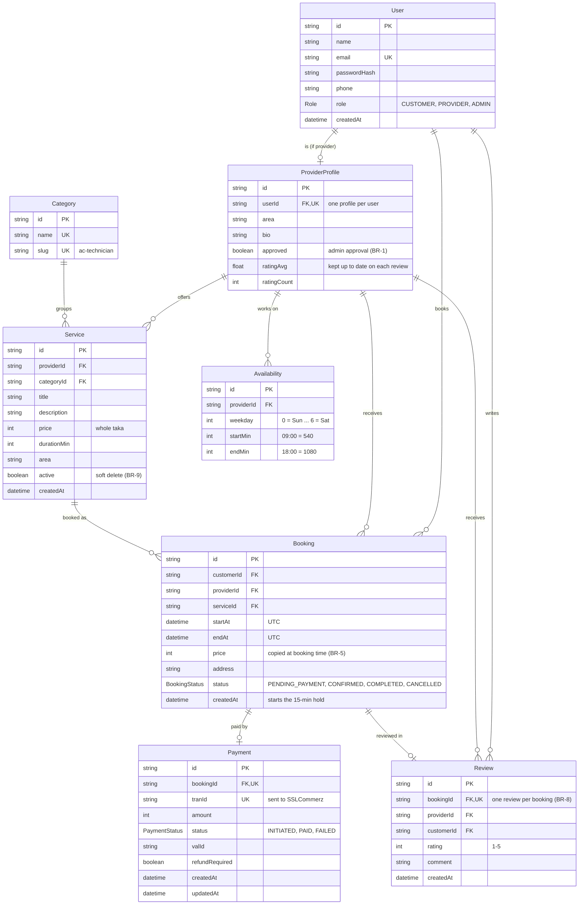

# ShebaGhor — Data model

8 tables. PK = primary key, FK = foreign key (points to another table), UK = unique.

## Diagram



## The same thing as boxes and lines (for paper)

```text
┌──────────────┐              ┌──────────┐      writes
│ Availability │    ┌─────────┤   User   ├──────────────────┐
└──────┬───────┘    │         └──────┬───┘                  │
       │            │                │                      │
       │works on    │is a            │                      │
       │            │                │books                 │
┌──────┴────────────┴────┐receives   │                ┌─────┴────┐
│    ProviderProfile     ├───────┐   │                │  Review  │
└─┬─────────────────────┬┘       │   │                └──┬────┬──┘
  │                     │        │   │                   │    │
  │                     │offers  │   │                   │    │
  │             groups  │        │   │                   │    │
  │ ┌──────────┐   ┌────┴────┐   │   │                   │    │
  │ │ Category ├───┤ Service │   │   │                   │    │
  │ └──────────┘   └────┬────┘   │   │                   │    │
  │                     │        │   │                   │    │
  │                     │        │   │                   │    │
  │                     │        │   │                   │    │
  │                     │      ┌─┴───┴─────┐ reviewed in │    │
  │                     └──────┤  Booking  ├─────────────┘    │
  │           booked as        └─────┬─────┘                  │
  │                                  │                        │
  │                                  │paid by                 │
  │                                  │                        │
  │                            ┌─────┴─────┐                  │
  │                            │  Payment  │                  │
  │                            └───────────┘                  │
  │                       receives (reviews)                  │
  └───────────────────────────────────────────────────────────┘
```

Every line is "1 to many" except **User → ProviderProfile**, **Booking → Payment** and **Booking → Review**, which are "1 to 0..1" (see the table below).

## Relationships in plain words

| From | To | Type | Meaning |
|---|---|---|---|
| User | ProviderProfile | 1 to 0..1 | A user has a provider profile only if their role is PROVIDER |
| User | Booking | 1 to many | A customer makes many bookings |
| User | Review | 1 to many | A customer writes many reviews |
| ProviderProfile | Service | 1 to many | A provider offers many services |
| ProviderProfile | Availability | 1 to many | Up to 7 rows, one working window per weekday |
| ProviderProfile | Booking | 1 to many | A provider receives many bookings |
| ProviderProfile | Review | 1 to many | A provider receives many reviews |
| Category | Service | 1 to many | Electrician groups many electrician services |
| Service | Booking | 1 to many | One service can be booked many times |
| Booking | Payment | 1 to 0..1 | A booking has at most one payment |
| Booking | Review | 1 to 0..1 | A booking has at most one review |

## Self-check
- **Why does `Booking` store its own `price`?** If the provider changes the service price later, old bookings keep the price the customer actually agreed to.
- **Why is `ProviderProfile` separate from `User`?** Area, bio, approval and rating only apply to providers, so they shouldn't be empty columns on every customer row.
- **Why does `Booking` have both `providerId` and `serviceId`?** You could reach the provider through the service, but the overlap check runs on `(providerId, startAt)`, so storing it directly makes that check one fast indexed query.
- **Why are free slots not a table?** They are calculated from `Availability` minus existing bookings, so they can never get out of sync.
